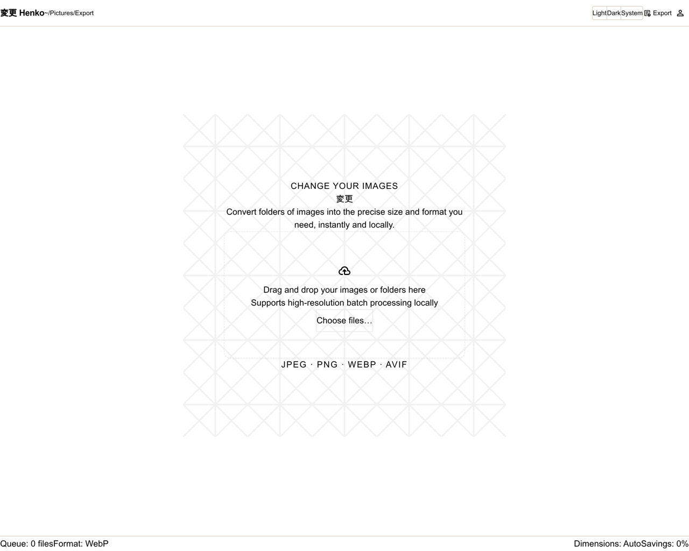
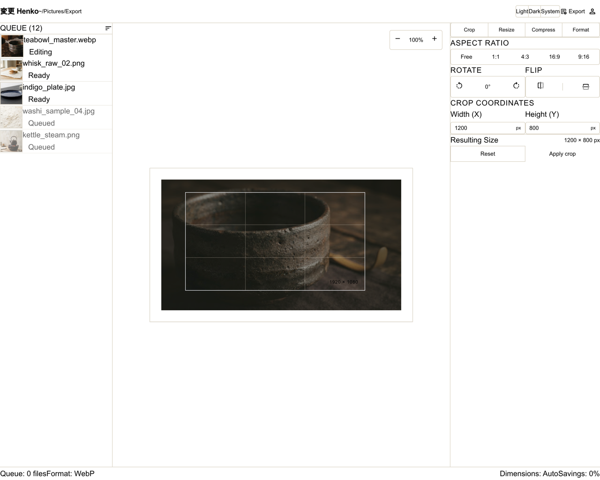
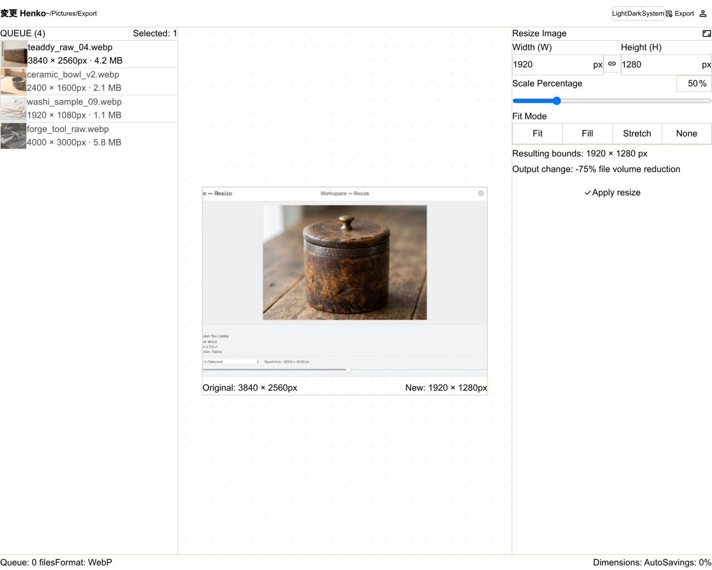
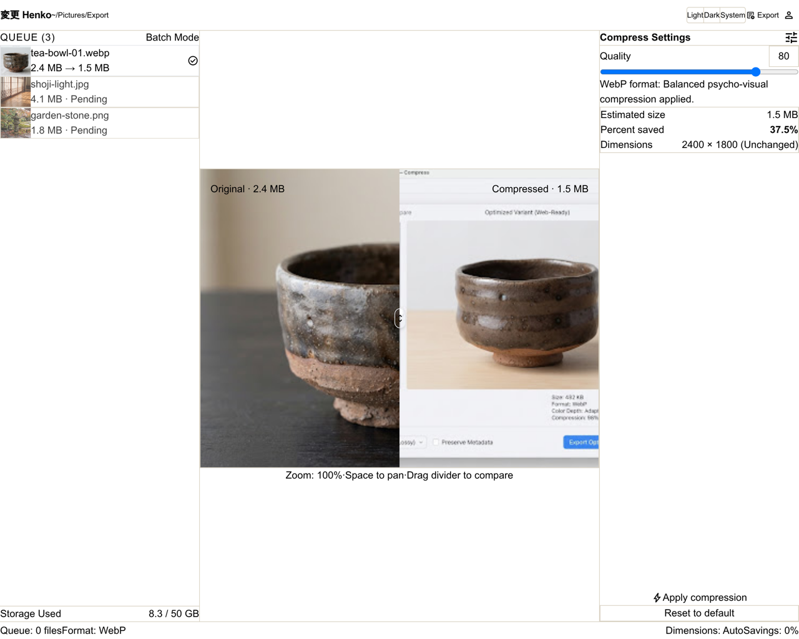
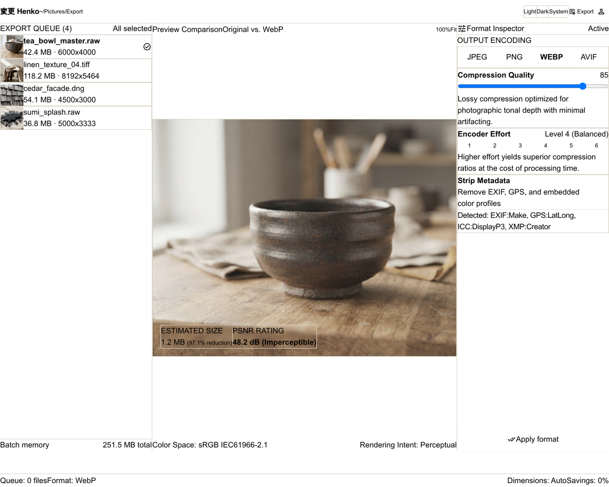
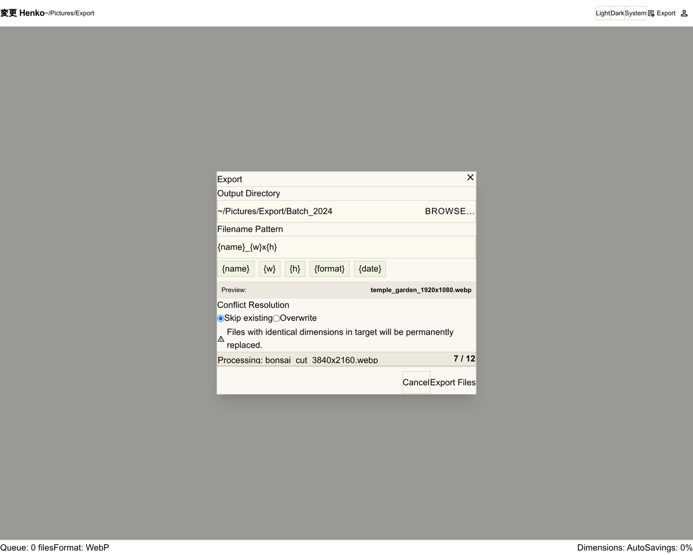

# Henko 変更

**A free, open-source image resize tool, cropper, compressor and converter for macOS, Windows and Linux.** One window, live before/after preview, batch export. No ads, no account, no uploads.

Henko (変更, "change") is a desktop image editor for the jobs you would otherwise open a browser tab for: resizing a photo for a listing, cropping a screenshot to 16:9, compressing a folder of JPEGs, or exporting PNGs as WebP. Everything runs on your own machine.

[releases]: https://github.com/henrychea/henko-image/releases/latest

## Download

**[Latest release →][releases]** · macOS · Windows · Linux · 9.6 MB (dmg) to 85 MB (AppImage)

| Platform | File | Size |
| --- | --- | --- |
| macOS 11+ (Intel and Apple Silicon) | [`Henko_0.1.0_universal.dmg`](https://github.com/henrychea/henko-image/releases/download/v0.1.0/Henko_0.1.0_universal.dmg) | 9.6 MB |
| Windows 10/11 x64 | [`Henko_0.1.0_x64_en-US.msi`](https://github.com/henrychea/henko-image/releases/download/v0.1.0/Henko_0.1.0_x64_en-US.msi) | 5.2 MB |
| Windows 10/11 x64 (alternative) | [`Henko_0.1.0_x64-setup.exe`](https://github.com/henrychea/henko-image/releases/download/v0.1.0/Henko_0.1.0_x64-setup.exe) | 3.4 MB |
| Linux x86_64 | [`Henko_0.1.0_amd64.AppImage`](https://github.com/henrychea/henko-image/releases/download/v0.1.0/Henko_0.1.0_amd64.AppImage) | 85 MB |

The builds are not code signed yet. On macOS, right-click the app and choose **Open** the first time. On Windows, SmartScreen shows a warning; choose **More info → Run anyway**. On Linux, `chmod +x Henko_0.1.0_amd64.AppImage` before running it.

## What it does

- **Crop:** drag a freeform frame, or lock it to 1:1, 4:3, 16:9 or 9:16. Rotate in 90° steps and flip horizontally or vertically.
- **Resize:** type a pixel width and height with the aspect ratio locked, or set a percentage. Choose fit, fill, stretch or none.
- **Compress:** set JPEG, WebP or AVIF quality from 1 to 100 and see the resulting file size next to the original before you save.
- **Convert:** open JPEG, PNG and WebP; save as JPEG, PNG, WebP or AVIF.
- **Batch:** queue as many images as you like, apply one set of settings to all of them, override any single image, then export the batch with a progress bar and a total-bytes-saved summary.
- **Name files your way:** export with a pattern such as `{name}_{w}x{h}` built from `{name}`, `{w}`, `{h}`, `{format}` and `{date}`.

## Why a local image tool instead of a website

- **Nothing is uploaded.** Files are read from and written to your own disk. There is no upload path and no analytics.
- **No size limits and no queue.** A 40-megapixel photo is processed at full resolution, not squeezed through a free-tier upload cap.
- **Works offline.** On a plane, on a locked-down work laptop, or behind a firewall.
- **No ads, no account, no telemetry.** There is nothing to sign into and nothing to pay for.
- **Real previews.** The compression estimate is computed from the actual encoder, on the actual image, before you commit to saving.

## Screenshots

| | |
| --- | --- |
|  |  |
| Drop images or pick a folder of files | Crop with aspect ratio presets |
|  |  |
| Resize by pixels or percent | Compress with a live size estimate |
|  |  |
| Choose the output format | Export the batch with a filename pattern |

The interface follows a Japanese print-inspired design system: washi-paper background, sumi ink text, a vermilion accent, and Noto Serif JP headings. The full contract is in [`DESIGN.md`](DESIGN.md); the screens it generated are in [`design/screens/`](design/screens).

## Formats

| | Open | Save |
| --- | --- | --- |
| JPEG | yes | yes |
| PNG | yes | yes |
| WebP | yes | yes |
| AVIF | needs system `dav1d` | yes |

EXIF and GPS metadata are dropped on export. Rotation recorded in the EXIF orientation tag is applied before any crop or resize, so photos from a phone come out upright.

## Keyboard and navigation

Everything reachable by mouse is reachable by keyboard: the batch list, the inspector tabs, the aspect presets and the quality slider all take focus, and the inspector fields respond to the arrow keys. `Esc` closes the export sheet.

## Build from source

Prerequisites: [Rust](https://rustup.rs) 1.88+, [Node.js](https://nodejs.org) 20+, [pnpm](https://pnpm.io) 9+, and the [Tauri system dependencies](https://tauri.app/start/prerequisites/) for your platform.

```bash
git clone https://github.com/henrychea/henko-image.git
cd henko-image
pnpm install
pnpm tauri dev          # run
pnpm tauri build        # produce an installer in src-tauri/target/release/bundle
```

Checks:

```bash
pnpm build                                      # typecheck and frontend build
cargo clippy --manifest-path src-tauri/Cargo.toml -- -D warnings
cargo test --manifest-path src-tauri/Cargo.toml
```

### Stack

Tauri 2 (Rust shell), SolidJS 2 with TypeScript and Vite (interface), Tailwind 4 (styling), and the Rust `image`, `webp` and `ravif` crates (pixels). The image pipeline runs in Rust on a four-thread pool, so exports stay fast and the result is identical on all three platforms.

### Releasing

Version lives in three files (`package.json`, `src-tauri/Cargo.toml`, `src-tauri/tauri.conf.json`). Bump all three, then:

```bash
pnpm release:tag            # refuses if the three disagree, creates v<version>
git push origin v0.1.0      # triggers the release workflow
```

`.github/workflows/release.yml` builds macOS (universal dmg), Windows (msi and NSIS exe) and Linux (AppImage) and attaches all four to one draft release. The landing page in `site/` deploys through `.github/workflows/pages.yml` to <https://henrychea.github.io/henko-image/>.

## Known limits

- **AVIF input** needs the system `dav1d` library, which is not bundled, so opening `.avif` files fails on a default install. AVIF output works.
- **Metadata is always stripped** on export. The "strip metadata" control does not yet have an off state.
- **No folder drop.** Files can be selected together, but dropping a directory does not walk it.
- **The canvas does not preview rotation or flip**; the exported file does.
- **Builds are unsigned and unnotarized.**
- The open accessibility and UX findings are listed in [`ANTISLOP-AUDIT.md`](ANTISLOP-AUDIT.md).

## License

[MIT](LICENSE) © 2026 Henry Chea.

The landing page photos are from Unsplash under the [Unsplash License](https://unsplash.com/license); see [`site/assets/CREDITS.md`](site/assets/CREDITS.md).
